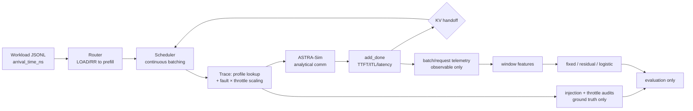

# Project Progress Report: Fail-Slow Fault Detection in Disaggregated LLM Serving

> Source document for DOCX + slides generation. Status legend used throughout:
> **Completed** = implemented + evidence cited; **Partial** = partly implemented, remainder specified;
> **In development** = exists but unverified; **Planned** = no implementation.
> Claim tags: **[measured]** = executed and logged; **[artifact]** = read from a committed file;
> **[inspected]** = static code reading; **[not available]** = missing evidence.
> No secrets are contained in this report. Nothing here was invented: every number cites its file.

## A. Project overview

**Title/domain.** Fail-slow fault detection for PD-disaggregated LLM serving, built as an
extension to LLMServingSim 2.0 (KAIST, ISPASS 2026). Repository checkout: `LLMServingSim/`
on branch `main` (see §K).

**Problem statement.** In disaggregated serving (separate prefill pool P, decode pool D, KV-transfer
links L), a *fail-slow* fault keeps serving but degrades performance: higher latency with no
error signal. Benign causes (long prompts, batch mix, demand peaks) also raise latency. The
detector must decide, per time window and from operational telemetry only, whether a slowdown
is a genuine resource degradation or normal workload variation — and ideally localize it to a
worker or link (`docs/fault_injection/PROGRESS_REPORT.md:12-36`).

**Background/motivation.** Real fail-slow faults are rare, unlabeled, and hard to reproduce, so the
project injects controlled synthetic faults into a deterministic, profile-driven simulator,
collects observable telemetry plus separate ground truth, and trains transparent baselines
first (`PROGRESS_REPORT.md:38-46`). Architectural reference: DeepSeek-V3 technical report
(§3.4 inference/deployment: P/D separation, expert parallelism, dispatch/combine; external
file `deepseekv3.pdf`, not in repo).

**Objectives / contributions.**
1. Resource-targeted fail-slow fault injection with audit-grade ground truth (Completed).
2. Observable-only telemetry + leak-guarded experiment framework (Completed).
3. Transparent detection baselines that separate workload variation from faults (Completed on
   40-window smoke set; retraining on new data is Planned).
4. Stateful synthetic GPU throttling as a *non-fault* degradation source, causally validated
   end to end (Completed, container-verified).
5. Reproducible daily-workload generator with noon-peak shape (Completed, single-region;
   multi-region/timezone variant is Planned).
6. 8-GPU 2-prefill/2-decode TP=2 topology on Qwen3-32B dense as the primary scale-up target
   (Completed config + host validation + container smoke; hardware accuracy inherited, not
   re-measured — see §G).

**Scope / success criteria.** Simulator fidelity is validated by determinism (identical seeds →
identical `Total clocks (ns)`) plus sparse hardware comparisons; detection is validated by
precision/recall/F1, healthy false-positive rate, and detection delay on held-out runs, with
honest negatives reported as findings (`AGENTS.md` honesty rules at `Project/AGENTS.md:24-26`).
Synthetic faults validate the *detection machinery*, never real-hardware detection.

## B. Current progress and status

**Executive summary.** The Llama-3.1-8B track is fully measured (validation green, smoke green,
ML report on 40 windows). The Qwen3-32B dense TP=2 scale-up is configured, host-validated,
and container smoke-tested with exact determinism. A per-GPU synthetic throttling module is
implemented, wired into the schedule-time hook, and causally validated (exact 1.5×/2.0×
compute scaling, hysteresis cycling, isolation). A paired 16-request dataset
(healthy/throttled/faulty/combined) and a 71-request daily-shape demo exist as telemetry in
`experiments/out/` (gitignored). Pending: regional multi-timezone demand, ML retraining on
new data, full-24h runs, learned localisation.

| # | Component / milestone | Objective | Status | Evidence | Outstanding |
|---|---|---|---|---|---|
| 1 | Fault injection (`serving/core/fault_injection.py`) | 6 modes × roles × time profiles with audit | Completed | 18 injection unit tests; DESIGN.md measured deltas (decode 2.0× → +39.5% clocks) | DP + faults excluded by design |
| 2 | Telemetry (`--telemetry-output`) | Observable batch/request/ITL CSVs, original CSV byte-identical | Completed | `TELEMETRY_SCHEMA.md`; leak-guard tests in `tests/test_fault_ml.py` | Per-rank columns not present |
| 3 | Experiment framework (`generate.py`, `matrix.yaml`, `manifest.py`) | Paired healthy/faulty runs, leak checks | Completed | Committed smoke bundle `experiments/fault_detection/smoke/` (5 runs, manifest) | 8-class throttle×fault matrix not yet encoded |
| 4 | Detection baselines (`ml/run.py`, `ml/features.py`) | Fixed-p99, residual-p99, logistic; stub localiser | Completed | `smoke/metrics.csv` + `smoke/report.md` (table §F) | Retrain on new data; genuine localiser; GBM/MLP |
| 5 | Upstream validation (`serving/validate.sh`) | Determinism across ~60 scenarios | Completed | 62/62 numerically exact; spot rerun 3 PASS (see §F) | CRLF working copy masks PASS labels (artifact, §G) |
| 6 | HW accuracy (`bench/`) | Sim vs real vLLM | Completed (4 configs) | Qwen3-32B TP=2 within +0.8–1.3% (see §F) | No comm-isolated microbenchmark; 2P2D topology inherited |
| 7 | Daily workload (`day_workload.py`) | Seeded NHPP day shape, noon peak | Completed | 4 host tests; 71-req demo + burst-gap-burst recovery demo | Multi-region/timezone variant (Planned) |
| 8 | Throttling (`gpu_state.py` + `__main__` wiring) | Per-GPU load state, hysteresis, compute-only slowdown | Completed | 9 host tests; container causal runs C/C2/D (see §F) | Slow-τ daily-timescale config untried |
| 9 | 2P2D TP=2 topology (`qwen32_2p2d_tp2.json`) | 8-GPU primary: 2 prefill + 2 decode stations | Completed | Deterministic smoke (3× identical), 8/8/8/8 station split | HW accuracy inherited, not re-measured |
| 10 | Paired 16-req dataset (A/B/C/C2/F/FT) | Healthy/throttled/faulty/combined comparison | Completed | `experiments/out/` CSVs + audits (see §F) | ML training on it (Planned) |
| 11 | Router absolute-path fix (`router.py`) | Accept absolute dataset paths | Completed | `tests/test_router_paths.py`; 2 new tests | None |
| 12 | 24h full-volume simulation | Real-rate full-day run | Planned | Cost datum: 71 heavy reqs ≈ 2.5h wall (§F) | Blocked by wall-clock physics, not code |
| 13 | Regional demand (multi-timezone) | `global_rate(t) = Σ regional` with DST | Planned | No `regions.py`; single-region only | Full Phase-1 plan exists in chat history |

## C. Technical approach and methodology

**Why simulation-first.** Real fail-slow events lack labels and reproducibility; the simulator gives
deterministic, profile-driven iteration latencies (profiler CSVs → trace → Chakra graph →
ASTRA-Sim cycles → scheduler), so "can we see it?" is separated from "can we learn it?"
(`PROGRESS_REPORT.md:38-46`). Transparent baselines (thresholds, healthy-only residuals)
precede any heavy model.

**Architecture.** Python frontend mirrors vLLM-V1 continuous batching (persistent `running[]`,
tail-preempt-only, FCFS `waiting[]`, token budgets, chunked prefill); per-batch traces carry
measured compute times + byte counts; ASTRA-Sim's analytical (congestion-unaware, ring
collectives) backend resolves communication; sim clock advances on ASTRA-Sim reports plus
`pass`-based idle hops. Faults scale trace rows at schedule time (future batches only);
throttling scales compute rows by per-GPU state at the same hook; in-flight batches are never
mutated. Telemetry (operational) and audit/manifest (ground truth) are separate files by
construction, enforced by unit-tested guards (`FORBIDDEN_COLUMNS`,
`check_observable_clean`).

**Key algorithms/models.**
- Detection features: 18 observable window aggregates (`ml/features.py:185`), healthy-only OLS
  residual `duration ~ (total_len, num_prefill, n_decode, kv_len)` + peer ratios (needs ≥2
  same-role instances).
- Throttling: `L += (u−L)·(1−e^(−dt/τ))`, `u` = completed-batch busy fraction (never queue
  length), hysteresis on/off thresholds, compute multiplier clamped by `m_min`; defaults
  τ=600 s, window 60 s, on/off 0.75/0.60, 1.5× (`gpu_state.py:38-46`). Demo runs retune τ/window
  explicitly and label them demo-tuned.
- Workload: non-homogeneous Poisson via thinning over a diurnal rate (morning ramp, Gaussian
  noon peak, afternoon decay, evening floor, optional bursts), one `random.Random(seed)`
  stream; identical config+seed → byte-identical output.

**Implementation decisions (rationale).** Instance/role-level (not per-rank) fault and throttle
application — the converter replicates one trace to all ranks (lockstep SPMD), so per-rank
divergence would be faked; documented in `DAY_SIMULATOR.md`. Compute-only throttling
(`comm_size` untouched) to avoid masquerading as network degradation. Schedule-time
application (in-flight immutable — no ASTRA-Sim API to rescale live work).

## D. Implementation details

**Layout (repo-relative).**
- `serving/__main__.py` — entry: CLI (`--cluster-config/--dataset/--output/--run-id/--fault-config/--telemetry-output/--throttle-config/--throttle-audit-output`), ASTRA-Sim IPC loop, fault/throttle hooks, audit write-out.
- `serving/core/` — `scheduler.py` (vLLM-V1), `router.py` (arrival/load, absolute-path fix),
  `request.py` (TTFT/ITL/latency stamps), `trace_generator.py` (profile lookup, TP/EP/PP logic),
  `graph_generator.py` (Chakra), `fault_injection.py` (6 modes:
  `compute_multiplicative/additive`, `kv_transfer_bandwidth`, `kv_handoff_delay`,
  `network_degradation`, `worker_stall`; roles prefill/decode/transfer/network; profiles
  step/intermittent/ramp_up/down/up_down), `gpu_state.py` (throttle module),
  `config_builder.py` (cluster→ASTRA-Sim inputs), `controller.py` (subprocess IPC).
- `profiler/` — vLLM layerwise profiler; `profiler/perf/<GPU>/<model>/bf16/tp<N>/` timing
  bundles; `profiler/models/*.yaml` architecture catalogs.
- `configs/` — `model/` (6 HFs: Llama-8B/70B, Qwen3-32B, Qwen3-30B-A3B MoE, Mixtral, Phi-MoE),
  `cluster/` (incl. new `qwen32_2p2d_tp2.json`, `moe_pd_tp2_pp2_instance.json`).
- `experiments/fault_detection/` — `workloads.py` (stationary/burst/sustained),
  `day_workload.py` (NHPP day), `generate.py` (paired runner), `matrix.yaml`
  (smoke/full profiles), `manifest.py`/`check_audit.py` (leak guards), `ml/` (features/run),
  `example_faults/`, `example_throttle/`, committed `smoke/` bundle.
- `tests/` — 5 files, 37 tests, all host-runnable (no binary needed).
- `docs/fault_injection/` — DESIGN, ARCHITECTURE_FINDINGS, TELEMETRY_SCHEMA, CONFIG_SCHEMA,
  PROGRESS_REPORT, DAY_SIMULATOR, README, RUNLOG (per-command evidence log).
- `bench/` — real-vLLM replay + sim comparison (`bench/examples/<hw>/<model>/` with
  `vllm/`, `outputs/sim.csv`, `validation/summary.txt`).

**Stack.** Host: Python 3.14, pytest 9.1 (36→37 pass, verified 2026-10-12), matplotlib/sklearn
for analysis. Container (`servingsim_docker`, image `astrasim/tutorial-micro2024`): Python
3.10, ASTRA-Sim analytical binary, vLLM profiler deps. Hardware profiled: RTX PRO 6000
(96 GB), RTX 4090 (tp1 only). No H100 profiles (70B config unrunnable — ruled out).

**Data structures.** Workload JSONL `{input_toks, output_toks, arrival_time_ns}`; trace rows
11-field `(layer, comp_time, …, comm_type, comm_size, …)`; batch/request telemetry CSVs
(schema §TELEMETRY_SCHEMA.md); `injection_audit.jsonl` + `throttle_audit.jsonl` (window +
batch rows) + `manifest.jsonl`; 2 s detector windows (configurable).

**Reproducibility safeguards.** Deterministic clocks (rerun-proven); seeded generators;
strict config validators (unknown keys rejected — caught two `_comment`-key failures during
validation); leak-guard unit tests; disabled-path bit-identical (fault/throttle off → zero
new code paths); gitignored outputs (`experiments/out/`, `experiments/report/`).

**Known gaps / debt.** CRLF working copy masks `validate.sh` PASS labels (artifact, §F);
`ThrottleManager.window_s` uses last GPU's value (multi-window configs rejected instead);
`single_node_moe_*` DP+EP paths unexercised by new work; `validate.unix.sh` (untracked,
another user's) left untouched.

## E. Prototype and demonstration

**Working capabilities.** Deterministic P/D-disaggregated simulation (TP/PP/EP/DP) with
fault injection, synthetic throttling, full telemetry, and baseline detectors — all executable
today in the container.

**Setup.**
1. `scripts/docker-sim.sh` (starts `servingsim_docker`, mounts repo); 2. `scripts/compile.sh`
   (builds ASTRA-Sim + Chakra; binary verified present).
3. Healthy run: `docker exec -w /app/LLMServingSim servingsim_docker sh -c "python3 -m
   serving --cluster-config configs/cluster/qwen32_2p2d_tp2.json --dtype bfloat16
   --block-size 16 --dataset experiments/out/e2e_smoke16.jsonl --output
   experiments/out/demo.csv --num-reqs 16 --run-id demo --telemetry-output
   experiments/out/demo_tel"`. Add `--throttle-config <json>` / `--fault-config <json>` as needed.
4. Matrix: `python -m experiments.fault_detection.generate --matrix
   experiments/fault_detection/matrix.yaml --profile smoke --out experiments/out/`.
5. ML: `python -m experiments/fault_detection.ml.run --data experiments/out --report experiments/report/`.
6. Regression: `bash serving/<CR-stripped copy> --clocks-only` with `BASELINES`=<stripped copy> (CRLF pitfall, §G).

**Demo assets.** `experiments/out/demo_H_demo.png` (arrivals/queue/busy over 30 sim-min),
`demo_F_demo.png`, `demo_FT_demo.png`; workload `demo_day.jsonl` (+manifest); paired
CSVs/audits for A/B/C/C2/F/FT. **Suggested 3-minute demo sequence** (tested): show day
workload arrival plot → run 16-req healthy vs throttled twin (or replay saved logs) →
compare clocks table (+31.8%) → open throttle audit transitions → TTFT-identical isolation
slide. Label scaled volumes explicitly.

## F. Experiments and results

**Research questions.** Can residuals separate faults from workload variation? Does throttling
change simulated execution (not just telemetry)? Do fault+throttle compound? Does the noon
peak engage throttling endogenously?

**Datasets.** Smoke: 5 paired runs (light/heavy/bursty × decode-2.0×/handoff), 40 windows
(22 healthy/18 anomalous), committed under `smoke/data/`. E2E: 16-req trace (seed 42) ×
{A,B,C,C2,D,F,FT}; 71-req/30-min day-shape trace (seed 7); 35-req burst-gap-burst trace.
Splits group by run/seed (pair-aware); raw telemetry preserved for regeneration.

**Setup.** Llama-8B TP=1 (smoke) and Qwen3-32B dense TP=2 2P2D (8 GPUs) in `servingsim_docker`;
2 s detector windows; logistic `max_iter=1000`.

**Results (measured, RUNLOG-logged).**

*Smoke detectors (`smoke/metrics.csv`, test split):*

| Baseline | P | R | F1 | Healthy FPR |
|---|---|---|---|---|
| Fixed p99 | 1.000 | 0.556 | 0.714 | 0.000 |
| Residual p99 | 0.857 | 0.667 | 0.750 | 0.125 |
| Logistic | 0.286 | 0.222 | 0.250 | 0.625 |

Stub localisation 0.475 (echoes ground truth — not a model result), abstention 0.075,
selective 0.594, mean delay 1.0 s vs 2 s floor, 4.049 ms/window. Headline contrast
(`smoke/report.md`): healthy-heavy windows 11–17 ms residuals ≈0 vs faulty-light ~22 ms
residuals ≈+11 ms, peer ratios 1.8–2.3. Recall is label-bounded (prefill windows of faulty
runs carry no mechanism effect).

*Hardware accuracy (`bench/.../Qwen3-32B/validation/summary.txt`, TP=2):* TTFT mean +1.3%,
TPOT mean +0.8%, latency mean +1.0% (p90–p99 similar). Llama-8B/RTX4090 within ~1–2.5%.

*Determinism:* r1≡r2≡r3 clocks 9509780493, CSVs byte-identical; station split 8/8/8/8 every run.

*Throttle causality (identical 16-req trace):*

| Run | Clocks (ns) | Δ | p50/p99 lat (s) | TTFT |
|---|---|---|---|---|
| A healthy | 9509780493 | — | 4.42/7.71 | 57 ms |
| B unreachable-θ | 9509780493 | 0 exact | identical | identical |
| C 1.5× decode | 12537453277 | +31.8% | 5.70/10.55 | identical (isolation) |
| C2 2.0× | 15594675002 | +64.0% | 7.06/13.61 | identical |
| F fault 2× | 15559896675 | +63.6% | 7.78/13.58 | 66 ms (backpressure) |
| FT both | 21665154168 | +127.8% | 10.83/19.68 | 66 ms |

473–487 batches scaled at exactly 1.5×/2.0× (applied/nominal ratios 1.4999/2.0000);
engage t=2.0 s all decode GPUs; D-run hysteresis on@18→off@31/40→on@46→off@52→on@70/72…;
per-instance independence (D0 vs D1 release 9 s apart).

*Link sweep (temp configs):* 16/32/64 GB/s → −0.68%/−1.01% clocks; TTFT p50
57.4M→48.0M→43.2M ns (transfer on prefill critical path); compute dominates.

*Daily demo (71 reqs):* 29.6 sim-min, p50 4.5 s, prefill busy 0.3%, decode ~19% each,
peak 5 req/min, max queue 2 — shape shown, no queueing pressure at this volume.

*Synthetic ML studies (`Project/plots/synth_v3–v6`):* host-only Gaussian resamples of the 40
smoke windows (NOT simulator evidence): best focal-loss F1 0.696, FPR 0.000 vs residual
0.723 — kept out of the repo tree deliberately.

**Interpretation.** Residuals help but n=40 is too small for superiority claims; throttling is
proven to move execution time monotonically with downstream queue/latency effects; fault and
throttle compound super-additively in clocks (+127.8%).

**Reproducibility.** Determinism rerun-proven; seeds/configs/versions in manifests; 62/62
clocks numerically exact vs baselines (see artifact note §G). Outstanding: retrain detectors
on the new 16-req + daily datasets; committed full-matrix runs; 24h run.

## G. Limitations and unresolved issues

**Confirmed.**
- Full-volume 24h sims are wall-clock-prohibitive (71 heavy reqs ≈ 2.5h; cost scales
  superlinearly via ASTRA-Sim per-iteration cost) — scaled/compressed demos required.
- Transfer fidelity: per-prefill-instance shadow-range modeling (P0→D0 ≡ P0→D1 by
  construction); link numbers uncalibrated (single 16 GB/s default, not NVLink); backend
  `congestion_unaware`; no comm-isolated microbenchmark — end-to-end +1% does not isolate comm.
- MoE timing tp1-only analytic; per-rank divergence unsupported (would be faked); DP + faults
  excluded; PP=4 MoE unverified; H100/70B unrunnable (no profiles); RTX4090 tp2 template broken.
- Localisation is a stub (0.475 echoes ground truth); no GBM/MLP, confusion matrix, top-k,
  overhead measurement (all disclosed in `smoke/report.md:56-63`).
- Docker Desktop flaky on host (2 daemon deaths in one session); ASTRA-Sim exists only in
  container — host cannot run sims.
- `validate.sh` FAIL labels under CRLF checkouts are a string-compare artifact (`\r` in
  `awk $2`); numeric deltas all +0.0000%, spot rerun with stripped files 3/3 PASS.

**Plausible risks.** Recall label-boundedness (prefill windows in faulty runs); logistic
overfits at n=40; decode-bottleneck conclusions may not transfer to prefill-bound regimes;
`validate.unix.sh` provenance unknown (another user's file, untouched).

## H. Future work and next milestones

| # | Task | Why | Outcome | Pri | Deps | Acceptance |
|---|---|---|---|---|---|---|
| 1 | Regional multi-TZ demand (`regions.py`) | brief requires `Σ regional`, DST | validated generator + CSV/plot | High | — | §2-style checks green (sum, TZ shift, seeds, no gaps) |
| 2 | Retrain detectors on new datasets | smoke n=40 insufficient | P/R/F1 + ablations on held-out runs | High | 1, paired data | healthy-peak/throttle FPR reported; no leakage (tests) |
| 3 | Genuine localiser head | stub is not a result | learned component attribution | Med | 2 | top-1/3 + confusion matrix |
| 4 | 1P2D heterogeneous topology | prefill over-provisioned (0.3%) | prefill-bottleneck contrast | Med | container | TTFT-bottleneck demonstrated |
| 5 | Slow-τ 24h-scale throttling | daily-timescale engagement | noon-peak-induced throttle | Med | 1 | on/off aligned to peak |
| 6 | Comm microbenchmark | comm accuracy unisolated | calibrated link numbers | Med | container | measured vs formula across sizes |
| 7 | Full-matrix + Qwen runs | pending since Stage 6 | 8B-vs-32B comparison | Med | 2 | committed bundle + report |
| 8 | Per-pair transfer modeling | station-independent transfers | pair-aware SEND/RECV | Low | ASTRA-Sim changes | P0→D1 ≠ P0→D0 demonstrable |

## I. Project report material (DOCX outline)

1. **Introduction** — problem (fail-slow vs workload), why simulation-first; evidence:
   PROGRESS_REPORT problem statement; Fig: P/D swimlane diagram (adapt
   `smoke/architecture.svg`).
2. **Background** — LLMServingSim 2.0, vLLM scheduling, ASTRA-Sim analytical backend,
   DeepSeek-V3 §3.4 reference; Table: profile bundles per GPU/model/TP.
3. **Methodology** — fault taxonomy (6 modes table + hook diagram), throttle model
   (equation, hysteresis figure from D-run transitions), workload generator (rate-curve
   figure), leak-guarded experiment design (telemetry vs audit table).
4. **Implementation** — module map (§D), 2P2D topology + NPU table, throttle wiring,
   validators; Listing: throttle config + CLI.
5. **Experiments** — smoke 40-window table (§F); E2E causal table (A–FT clocks +
   latencies); link sweep; daily demo plots (`demo_H_demo.png`).
6. **Results & analysis** — residual-vs-fixed contrast with recall-bound caveat;
   exact-ratio throttling proof; compounding FT result; honest neutrals (fast-link
   transfer, light-load demo).
7. **Limitations** — §G verbatim discipline: synthetic≠hardware, transfer fidelity,
   wall-clock scaling, stub localiser.
8. **Conclusion & future work** — §H top 4.
*Missing and needed:* retrained-detector numbers (§H.2), regional-demand validation plots,
comm microbenchmark (§H.6). Figures to embed: architecture.svg, demo_H/F/FT plots,
validation summary tables.

## J. Presentation plan (≤15 min total)

| # | Slide | Message | Content / evidence | Min |
|---|---|---|---|---|
| 1 | Title | Fail-slow detection in disaggregated LLM serving | Title, team, simulator+extension framing | 0.5 |
| 2 | Problem | Slow ≠ broken; workload also slows | P/D diagram; latency-overlap sketch | 1.0 |
| 3 | Objectives | 4 contributions | Bullets + success criteria | 0.5 |
| 4 | Methodology | Simulate → inject → detect, leak-free | Mermaid pipeline (from §C) | 1.5 |
| 5 | Simulator | Profile-driven + analytical comm | TP table; +1% HW validation (Qwen32 TP=2) | 1.5 |
| 6 | Faults & throttling | Two separate mechanisms | 6-mode table; L-equation + hysteresis transitions | 1.5 |
| 7 | **Demo** | It runs: day load → throttle → fault | `demo_H_demo.png`; live or replayed twin-run clocks (+31.8%) | 3.0 |
| 8 | Results | Residuals help; throttling proven causal | Smoke table; A–FT clocks table; exact 1.5×/2.0× ratios | 2.5 |
| 9 | Limitations | What we don't claim | Synthetic≠HW; transfer fidelity; wall-clock; stub localiser | 1.0 |
| 10 | Future work + close | Regions, retraining, localiser | Roadmap top-4; takeaway line | 1.0 |
| | | **Total** | | **14.0** (+1.0 buffer) |

## K. GitHub repository and reproducibility

- **Remotes (verified `git remote -v`):** push/fetch `fail_slow` =
  `https://github.com/Asvinthk/Fail_Slow_Fault_Detection_in_LLM_Serving.git` (write target);
  `origin` = `https://github.com/casys-kaist/LLMServingSim.git` (upstream, read-only).
  Public accessibility of `fail_slow` was not verified from here (no network check performed).
- **Branch/HEAD:** `main` @ `e691da5` (+12 newer local commits shown in log: reproducibility,
  scaffolding cleanup, telemetry fixes). Working tree holds intended uncommitted work
  (2 modified: `serving/__main__.py`, `serving/core/router.py`, `RUNLOG.md`; 11 untracked new
  files); nothing staged; no commits made by this agent.
- **Setup:** `scripts/docker-sim.sh` → `scripts/compile.sh` → container CLI (see §E).
  Assumptions: Docker Desktop running; repo mounted at `/app/LLMServingSim`; Python 3.10 in
  container, 3.14 on host (pytest-only).
- **Tests:** `pytest tests/` → 37 passed (verified live this session): 18 fault-injection,
  leak-guard/ML, 4 day-workload, 9 throttle-state/wiring, 2 router-path. Binary-dependent
  tests are absent by design (marked; sims run in container).
- **Reproduction:** §E commands + seeds in manifests; determinism gate (`Total clocks`
  equality) before any effect claim. Missing from git (by convention, gitignored):
  `experiments/out/` (all sim telemetry/audits/datasets), `experiments/report/`,
  `outputs/` scratch, `plots/` synth studies (live outside repo at `Project/plots/`).

## L. Evidence index and outstanding information

**Index (what each file establishes).**
- `AGENTS.md` (Project root): environment, exact CLI pipeline, honesty rules, 8B→32B direction.
- `LLMServingSim/README.md:42-46`: upstream v2.0 provenance (ISPASS 2026).
- `docs/fault_injection/RUNLOG.md`: every executed command + result (determinism proofs,
  causal tables, failures with fixes).
- `DESIGN.md` / `ARCHITECTURE_FINDINGS.md`: hook semantics, transfer-overlap honest
  negative, per-pair impossibility proof.
- `TELEMETRY_SCHEMA.md`: observable vs ground-truth column contract.
- `PROGRESS_REPORT.md`: method, stub-localiser disclosure, completed/pending ledger.
- `DAY_SIMULATOR.md` + `docs/RESOURCE_AWARE_SIMULATOR_PLAN.md`: build notes, deferred scope.
- `serving/core/fault_injection.py:31-42,152-182`: modes/roles/profiles, targeting, stall.
- `serving/core/gpu_state.py:38-46,97-139`: throttle defaults, state machine, audit rows.
- `serving/__main__.py` (flags, `_throttle_tick`, hooks, audit writers): wiring proof.
- `serving/core/router.py:119` + `tests/test_router_paths.py`: absolute-path fix.
- `experiments/fault_detection/{day_workload,generate,matrix.yaml,manifest,check_audit}.py`: generators, pairing, leak enforcement.
- `ml/{features,run}.py:20,52,133,185`: forbidden columns, 2 s windows, residual model, baselines.
- `smoke/{report.md,metrics.csv,data/manifest.jsonl}`: frozen 40-window evidence.
- `bench/examples/RTXPRO6000/Qwen3-32B/validation/summary.txt`: TP=2 hardware accuracy.
- `configs/cluster/qwen32_2p2d_tp2.json`: primary topology + embedded caveats.
- `profiler/perf/`: measured-bundle inventory (TP coverage table §F/G).

**Could not verify.** Public visibility of the `fail_slow` remote; exact wall-clock of
individual E2E runs (only session totals logged); `validate.unix.sh` authorship/purpose;
contents of `assignement 2.docx` (user file, not opened).

**Missing results/artifacts.** Retrained detectors on new data; regional-demand plots;
comm microbenchmark; full-matrix bundle; 24h run; learned localiser; overhead measurement.

**Not inferable from repo.** Real regional traffic shares; true NVLink/PCIe effective
bandwidths for these cards; physical thermal constants; whether subtle severities are
detectable (requires the retraining experiment).

**Prioritized next-do checklist.**
1. [ ] Restart Docker; rerun one smoke twin to reconfirm environment health.
2. [ ] Implement `regions.py` + validation tests/plots (unblocks the brief's Phase 1).
3. [ ] Encode 8-class throttle×fault matrix; run short paired sets.
4. [ ] Extend features (lags, throttle-state) + leak tests; retrain; report held-out P/R/F1, FPR on peak/throttled healthy, ablations.
5. [ ] Honest 24h-scaled overnight run only after 1–4 pass; record wall/sim ratio.
6. [ ] Write DOCX from §I; build slides from §J (14 min + buffer).
